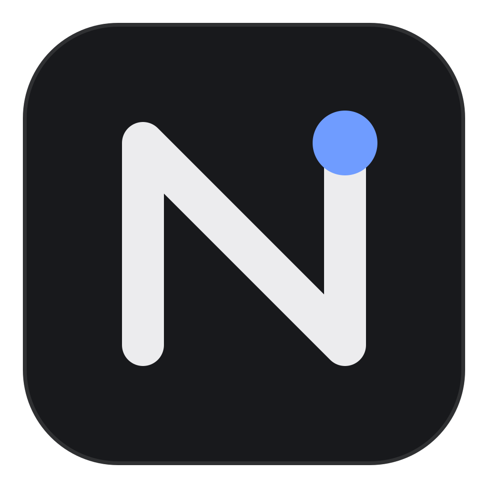
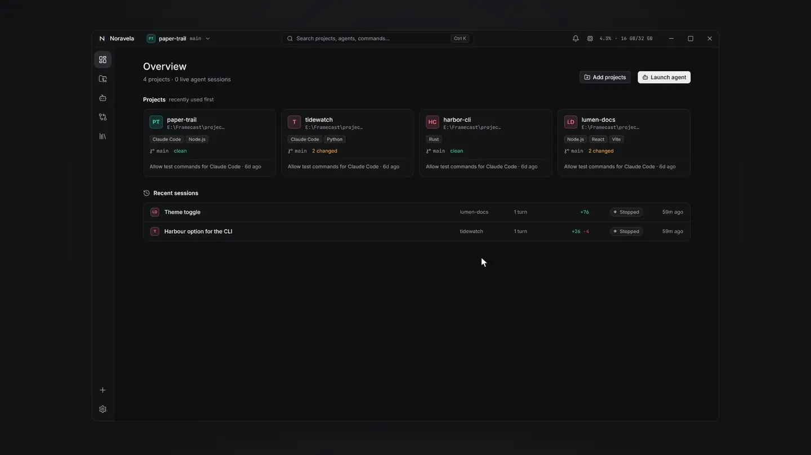
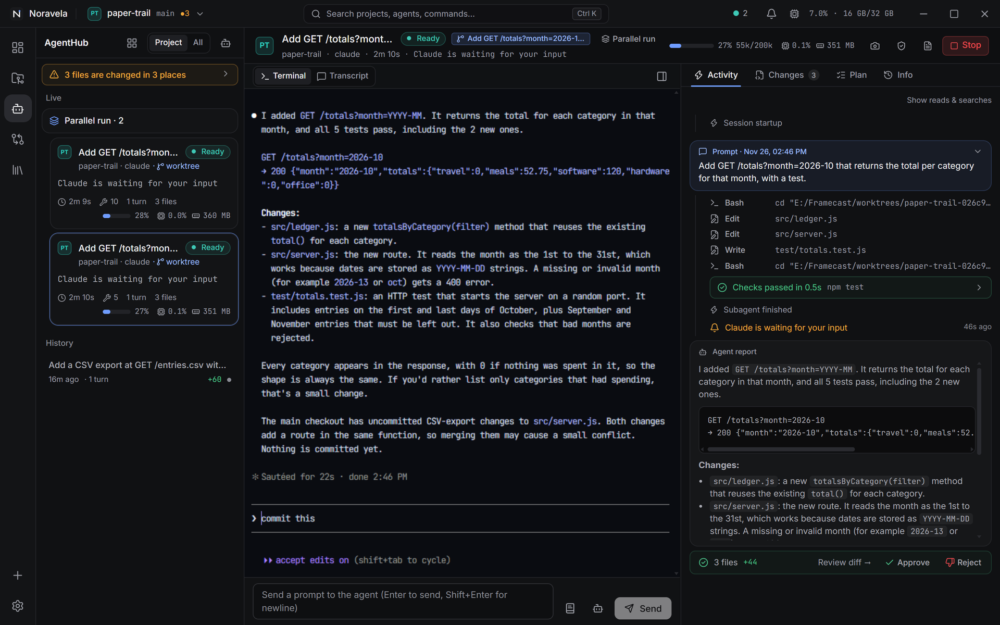
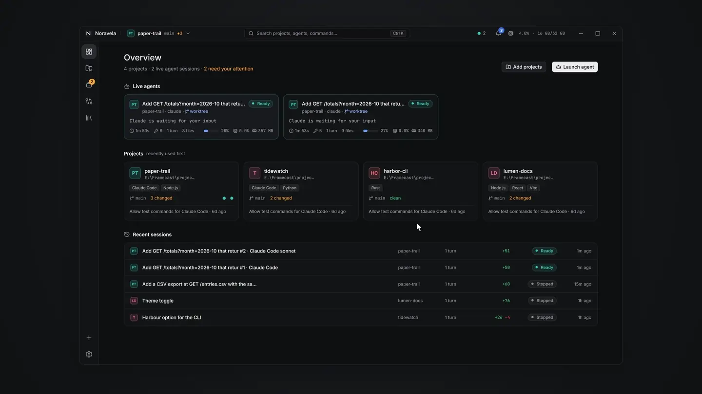
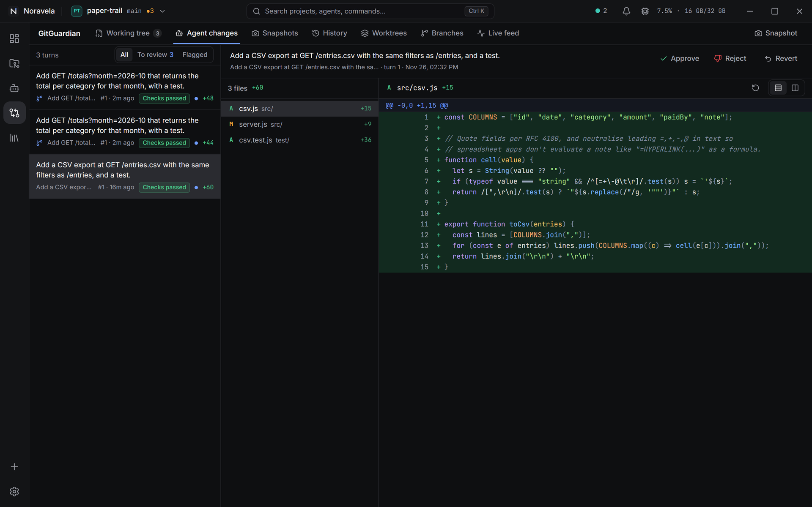
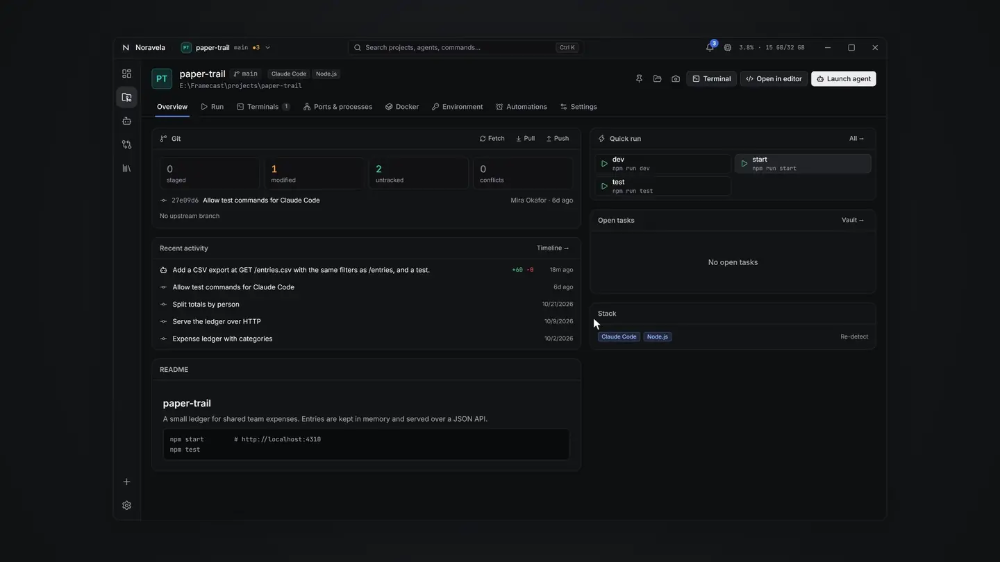
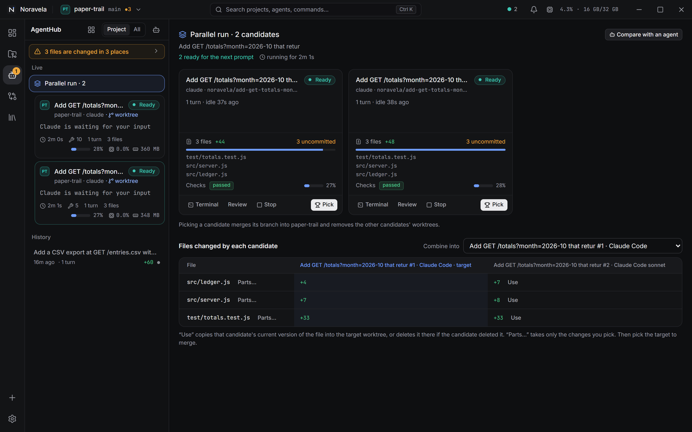
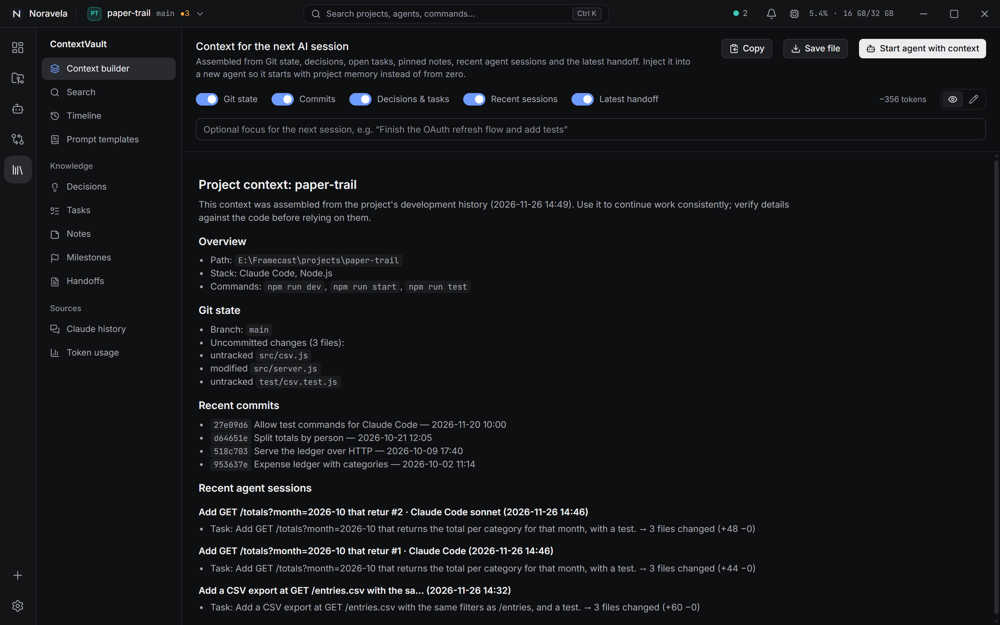
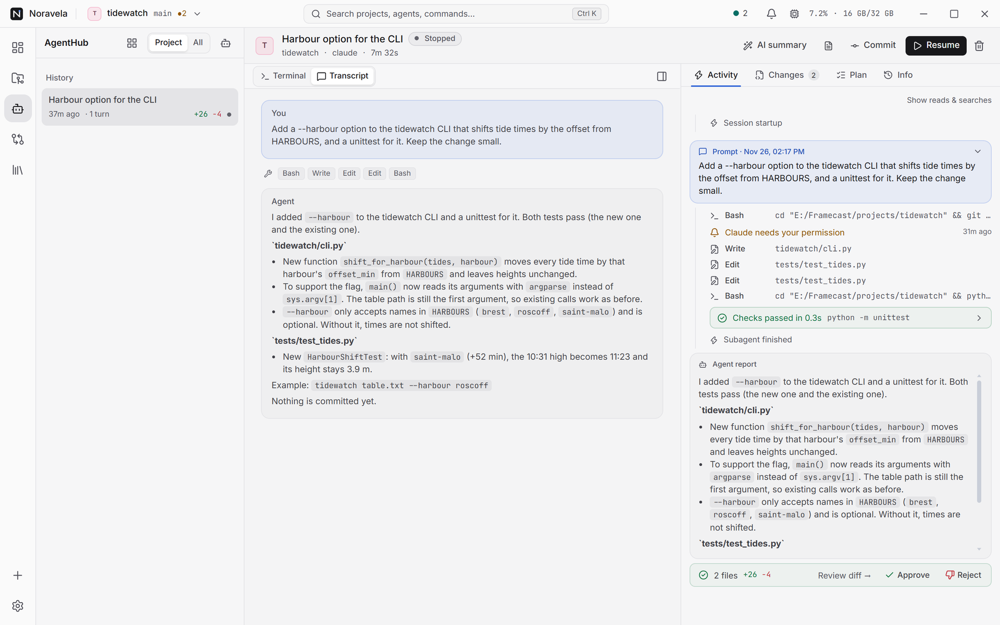
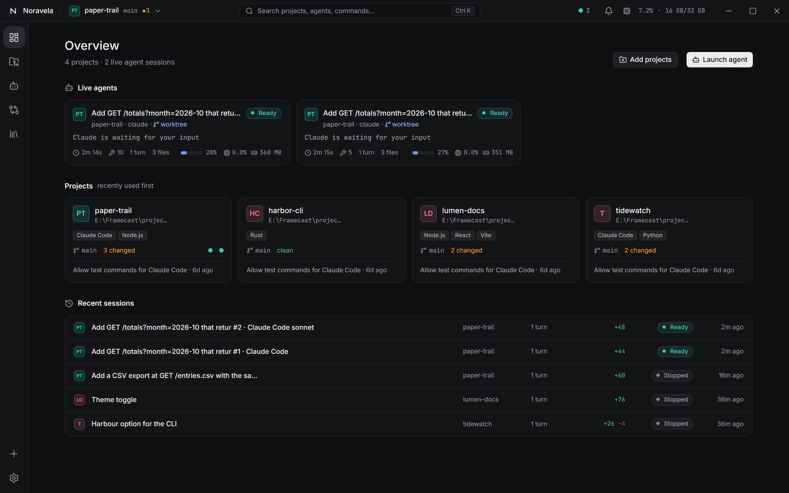

# Noravela

### Run coding agents on your own repositories and see every change they make

Claude Code, Codex, Gemini, OpenCode and Aider run in real terminals inside Noravela. 
Every turn they take is recorded with a snapshot before and after, a diff, the project's checks and the agent's own report.

Windows 10 and 11, x64 · updates itself · [all releases](https://github.com/shapikkk/Noravela-releases/releases)

 

This repository hosts the installers and the update manifest. Installed copies of Noravela update themselves from here.

## What it does

### Watch agents work

Each agent runs in an embedded terminal, so you can type into it as usual. Next to it, the activity feed shows what the agent is doing: the files it writes, the commands it runs, when it needs your permission and when its turn is over. For Claude Code this comes from its hooks, for Codex and OpenCode it is read from their session files.

When a turn ends, Noravela runs the project's check command, for example `npm test`, and shows whether it passed next to the summary the agent wrote.

### Review every turn

Before each prompt Noravela takes a snapshot of the project, and after the turn it takes another. That gives you a diff of exactly what one prompt changed, even when nothing was committed. Approve a turn, reject it and send the reason back to the agent, or revert one file or the whole turn. Snapshots live in a separate repository, so your own Git history stays untouched.

### Run several agents on one task

Start the same task two, three or four times, each in its own Git worktree and branch, with the same agent or with different agents and models. All candidates show up on one screen with their changes and check results. Pick the best one to merge, or combine whole files and individual parts from several candidates into one branch.

### Notice when agents get in each other's way

If a Claude Code session is about to write a file that another running session already changed in the same folder, the edit waits for your confirmation and the agent is told who changed it. Changes made by agents without hooks are picked up from the file system. Agents can also message each other through Noravela's MCP server.

### Keep project memory

ContextVault keeps decisions, tasks, notes and handoffs per project, searches across prompts, agent reports and Claude Code transcripts, and builds a short brief from Git state, recent sessions and open tasks that you can hand to the next agent.

### Everything else

- An overview of all projects with their branch, uncommitted changes and running agents
- A project switcher (`Ctrl+B`) and a command palette (`Ctrl+K`) for projects, agents and actions
- Scripts from `package.json`, Cargo, Make and others run in built-in terminals; listening ports and Docker containers are shown per project
- Agent sessions are restored after a restart, with the exact conversation for Claude Code, Codex, Gemini and OpenCode
- Prompts sent while an agent is busy are queued and go out when its turn ends
- Scheduled agents per project
- System notifications when an agent needs input or finishes, an inbox in the title bar, and agents keep running in the tray when the window is closed
- Dark and light themes, interface scale from 90 to 140 %

## Getting started

1. **Install.** Download `Noravela_<version>_x64-setup.exe` from [Releases](https://github.com/shapikkk/Noravela-releases/releases/latest) and run it. It installs for the current user and needs no administrator rights. The `.msi` is there for managed installations.
2. **Add projects.** Click *Add projects* and pick a folder. Noravela finds the Git repositories inside it and detects their stack and run commands.
3. **Install an agent.** Noravela works with the agent CLIs you already have. *Settings → AI tools* shows which ones are installed and can install or update Claude Code, Codex, Gemini and OpenCode.
4. **Launch an agent.** Press `Ctrl+Shift+A`, pick the project and the agent, describe the task and launch. Leave the task empty to start an interactive session.
5. **Add a check.** In the project's *Settings* tab, set a check command such as `npm test` or `python -m unittest`. It runs after every agent turn.
6. **Review.** Open *GitGuardian → Agent changes* to go through turns, or use *Review diff* at the end of a turn in the activity feed.
7. **Try worktrees.** Turn on *Isolated worktree* in the launch dialog to give an agent its own branch and folder. Set *Parallel agents* to 2, 3 or 4 to compare several attempts at the same task.

## Supported agents

| Agent | Status in Noravela | Restores the exact conversation |
| --- | --- | --- |
| Claude Code | Live status, tool calls, permission requests and reports from its hooks | Yes |
| Codex CLI | Turn status from its session files | Yes |
| OpenCode | Turn status from its session database | Yes |
| Gemini CLI | Status from terminal activity | Yes |
| Aider and custom commands | Status from terminal activity | No |

## Keyboard

| Action | Shortcut |
| --- | --- |
| Command palette | `Ctrl+K` |
| Switch project | `Ctrl+B` |
| Launch agent | `Ctrl+Shift+A` |
| Next agent that needs you | `Ctrl+J` |
| New terminal | `Ctrl+Shift+T` |
| Open in editor | `Ctrl+Shift+E` |
| Snapshot | `Ctrl+Shift+S` |
| Switch module | `Ctrl+1` … `Ctrl+5` |
| Next or previous project | `Ctrl+Alt+↓` / `Ctrl+Alt+↑` |

## Requirements

- Windows 10 or 11, x64
- Microsoft Edge WebView2 runtime, installed automatically if missing
- Git
- At least one agent CLI for the agent features

## Your data

Noravela has no account and sends nothing about your projects anywhere. Its database, snapshots and settings stay in `%APPDATA%\dev.noravela.app`. The agents talk to their own providers as they always do. The only request Noravela makes on its own is the update check against this repository.

## Installer warning

The installer is not signed with an Authenticode certificate yet, so Windows SmartScreen may show an "unknown publisher" warning. Choose *More info → Run anyway* to continue. Updates are verified with Noravela's own signing key before they are installed.

## Feedback

Report problems and ideas in [Issues](https://github.com/shapikkk/Noravela-releases/issues).
